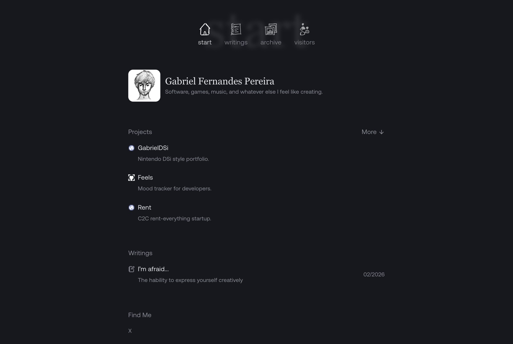
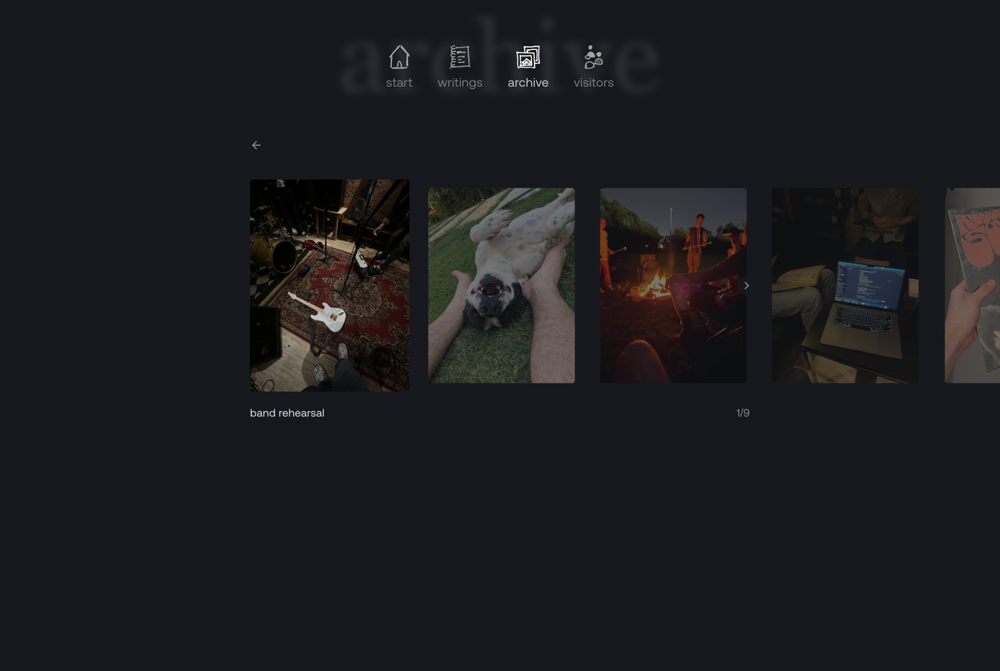

# gabrielfp.com

My personal site: the projects I build, the things I write, and a photo archive.

**Live:** [gabrielfp.com](https://gabrielfp.com)



## What's in it

- **Projects.** A short list on the home page, with the rest one click away.
- **Writings.** Articles and journal entries written in MDX, with frontmatter for dates and summaries.
- **Archive.** A horizontal filmstrip of photos. Captions and years come straight from the filenames, so adding a picture means dropping a file into `public/archive/pictures`.
- **Hand-drawn navigation.** Sketch-style icons with the current page's name written large behind them.



## Stack

| | |
|---|---|
| Framework | Next.js 16 (App Router, statically rendered) |
| UI | React 19, Tailwind CSS, Framer Motion |
| Content | MDX via `next-mdx-remote`, `gray-matter`, `remark-gfm` |
| State | Jotai, for small UI state that survives navigation |
| Hosting | Vercel |

## How it's built

- **Content as files.** Writings live in `src/content/writings` and photos in `public/archive/pictures`. No CMS and no database. Build time reads the folders.
- **Filenames as metadata.** `2019-summer-in-rio.jpg` becomes the caption "summer in rio" from 2019. Image dimensions are read at build time so the filmstrip never shifts while photos load.
- **One source of truth for site data.** Projects and links live in `src/data`, so the home page is just layout.
- **Light and dark themes** through `next-themes` and CSS variables.

## Run locally

```bash
npm install
npm run dev     # http://localhost:3000
```

## Contact

[gabrielfp.com](https://gabrielfp.com) · [X](https://x.com/gabrielfp101) · [gfernandespereira18@gmail.com](mailto:gfernandespereira18@gmail.com)
